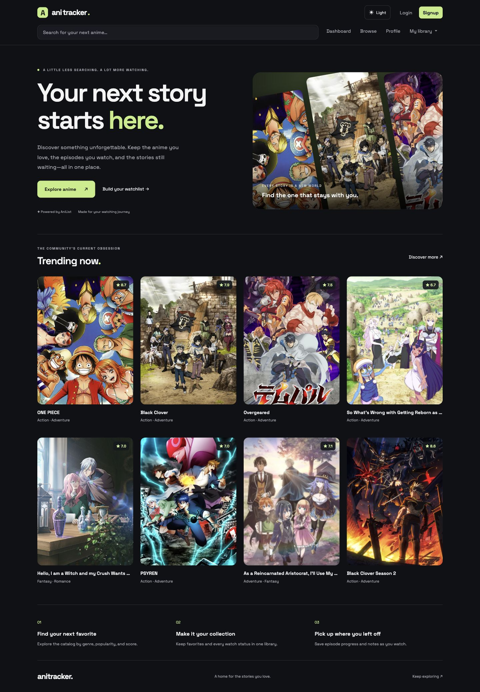

# AniTracker

**Your next story starts here.** A personal anime discovery and tracking app that brings browsing, favorites, watch status, episode progress, and notes into one calm interface.


## Experience

- Live AniList discovery with genre filters, sorting, pagination, and debounced search.
- Personal library with planned, watching, completed, on hold, and dropped states.
- Favorites that preserve watch progress when removed.
- Episode tracking and per-episode notes stored in Supabase.
- Real profile statistics derived from the authenticated library.
- Light and dark themes initialized before first paint, with a persisted preference and a system default.
- Responsive poster grids, keyboard-accessible controls, native modal focus trapping, and reduced-motion support.
- Cached server state, lazy route modules, lazy poster loading, and retryable API errors.

## Screenshots

Verified desktop and mobile captures are in `docs/screenshots/`. A workflow GIF can be added after testing with an authenticated account.

| Capture | Suggested file |
| --- | --- |
| Desktop home, light mode | `home-light.jpg` |
| Desktop home, dark mode | `home-dark.jpg` |
| Mobile discovery | `home-mobile.jpg` |
| Episode note workflow GIF | `episode-notes.gif` |

Include your own screenshots rather than fabricated user statistics. Anime artwork and catalog metadata are supplied by AniList; the app does not host streaming video.



## Stack and architecture

This repository uses **React + Vite**, with React Router for client-side navigation. It is not a Next.js application and has no server components. Tailwind handles layout utilities; CSS variables define shared theme colors and the discovery design system. No icon or animation framework is required.

```text
src/
├── api/
│   ├── anilist/       # Typed GraphQL requests and catalog operations
│   └── supabase/      # Library persistence and episode notes
├── components/
│   ├── anime/         # Posters and actual airing countdowns
│   ├── layout/        # Navigation and debounced search
│   └── ui/            # Buttons, inputs, badges, dialogs, theme toggle
├── context/           # Auth session and account-scoped library queries
├── hooks/             # TanStack Query catalog hooks
├── pages/             # Lazy-loaded application screens
├── router/            # Public routes, auth gates, and route fallback
├── types/             # Catalog and detail types
└── index.css          # Responsive design system and theme tokens
supabase/schema.sql    # New-project table and ownership policies
```

One auth provider owns session initialization and subscription cleanup. One library provider uses a query key scoped to the current account. Catalog reads go through a typed HTTP/GraphQL helper that propagates failures to query consumers. Mutations preserve existing library fields and refresh the shared library snapshot. Native dialogs keep the background inert and return focus to the trigger.

## Local setup

1. Install **Node.js 22.12+** (or a current supported LTS) and npm.
2. Install dependencies:

   ```bash
   npm ci
   ```

3. Create a Supabase project. For a fresh database, run `supabase/schema.sql` in its SQL editor. The script is intended for initial setup; review existing schema and policies before adapting it to an existing project.
4. Copy the environment template:

   ```bash
   cp .env.example .env
   ```

   Set `VITE_SUPABASE_URL` and `VITE_SUPABASE_ANON_KEY` to your project's URL and **public** anon/publishable key. Never put a service-role key into a `VITE_` variable: these values are included in the browser bundle. Row-level security protects each user's records.
5. Configure Supabase Auth's site URL and allowed redirects for your local and deployed origins. When email confirmation is enabled, confirm the signup email before signing in.
6. Start the app:

   ```bash
   npm run dev
   ```

AniList discovery requires network access to `https://graphql.anilist.co`; catalog requests are subject to its rate limits.

## Quality checks

```bash
npm test
npm run lint
npm run build
npm run preview
```

Strict TypeScript and ESLint run separately; `build` includes TypeScript validation. See `docs/engineering-review.md` for changes, verification, and remaining integration checks.

## Deployment

Deploy the generated `dist/` directory to a static host and configure an SPA fallback to `index.html` so direct links such as `/anime/21` work. Configure environment values before building, then add the deployed origin to Supabase Auth settings. No backend credentials or environment files should be committed.

## Engineering decisions and limitations

- CSS transitions provide hover feedback without adding an animation dependency.
- Absolute AniList airing timestamps drive countdowns; missing schedules never become invented seven-day timers.
- Genre-derived recommendations are a discovery heuristic, not a machine-learning recommender.
- Full email/auth and database mutation verification requires a test account and configured Supabase policies.
- Episode-note updates use read/merge/write semantics; concurrent edits from multiple devices can overwrite one another. A Postgres RPC would be the next step for atomic note updates.
- Accessibility features are implemented, but this project does not claim a completed WCAG audit or measured Core Web Vitals.
